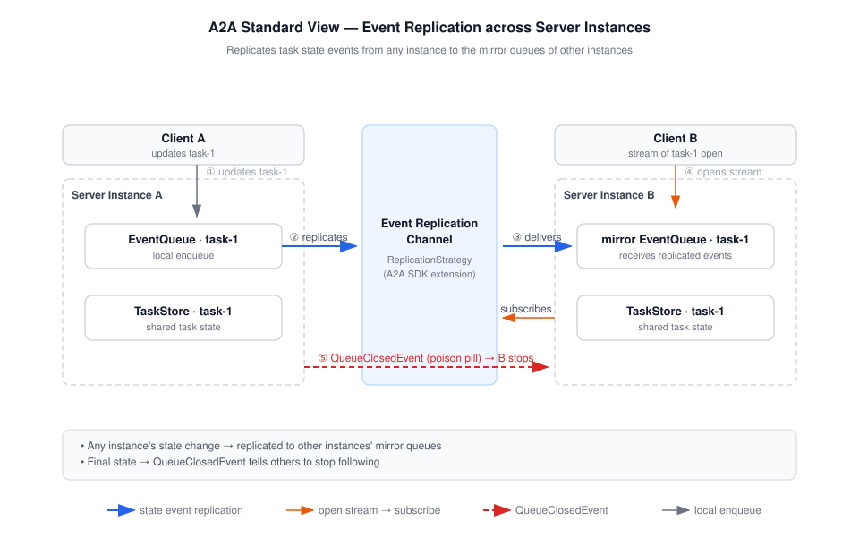
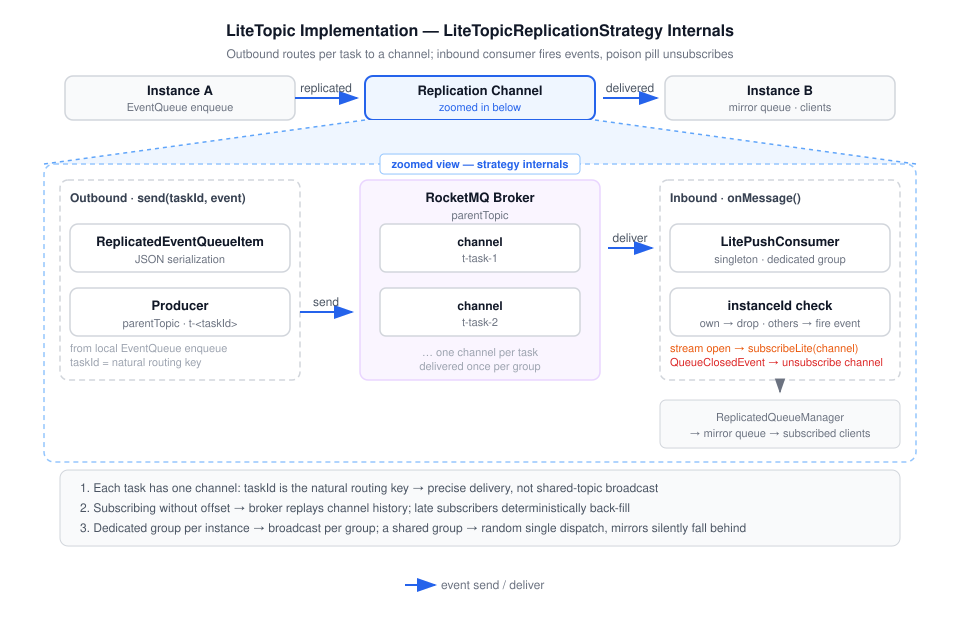

# RocketMQ A2A Replicated Queue Manager (LiteTopic)

A2A Java `ReplicationStrategy` backed by RocketMQ **LiteTopic**: per-task channel precise delivery for
multi-instance A2A deployments.

## What it solves

A2A's default `InMemoryQueueManager` keeps task event queues in one JVM. With multiple instances, a
client routed to an instance that does not host the task's queue sees a broken event stream. The
official fix (`extras/queue-manager-replicated`) delegates replication to a `ReplicationStrategy`; its
only implementation (`ReactiveMessagingReplicationStrategy`) writes every event to one shared Kafka
topic, so either every instance consumes the full topic (broadcast, per-instance consumer groups) or
the cluster is capped by partition count (shared group). Both modes pay the cost of the shared-topic
model.

This strategy maps every task to its own LiteTopic channel `t-<taskId>`:

- **Precise delivery**: `taskId` is the natural routing key; an instance receives only events for
  tasks whose channels it subscribes — no broadcast amplification, no partition-count cap.
- **Per-instance groups = broadcast**: every instance consumes its own pre-created group; Lite broker
  dispatch delivers once per group, so each replicated event reaches every subscribing instance while
  channels keep the delivery scoped to relevant tasks.
- **Deterministic back-fill**: subscribing without an offset option makes the broker replay the
  channel history, so a late subscriber gets events produced before its subscription (replaces the
  Kafka grace period).
- **Poison pill as channel close**: `QueueClosedEvent` unsubscribes the channel; channel TTL (based on
  last message store time, independent of consumption progress) reclaims storage.



## How it works

```
ReplicatedQueueManager
  └── ReplicationHook.onEnqueue ──► ReplicationStrategy.send(taskId, event)
                                       │  serialize ReplicatedEventQueueItem (JsonUtil)
                                       ▼
                              Producer → parentTopic + setLiteTopic("t-<taskId>")
                                       │  + instance-id property (self-receipt guard)
                                       ▼
                          LitePushConsumer.subscribeLite("t-<taskId>")  [idempotent]
                                       │
              inbound MessageListener ◄┘  drop self-received → fire CDI Event<ReplicatedEventQueueItem>
                                       │
              ReplicatedQueueManager.onReplicatedEvent (official observer)
```



Subscription lifecycle: a client opening a task stream (`LiteTopicTaskStreamLifecycleHook.onSubscribe`)
subscribes its channel; the poison pill unsubscribes it. `send()` never subscribes — replication and
mirroring are orthogonal, and the back-fill on subscribe makes eager mirroring unnecessary. The
inbound listener fires `ReplicatedEventQueueItem` as a CDI event — the same seam the official
reactive-messaging strategy uses.

## Usage

Add the dependency and configure a CDI producer for the config:

```java
@Produces
@ApplicationScoped
LiteTopicReplicationConfig config() {
    return LiteTopicReplicationConfig.fromEnv();
}
```

| Env var | Required | Default |
| --- | --- | --- |
| `ROCKETMQ_ENDPOINTS` | yes | — |
| `ROCKETMQ_ACCESS_KEY` / `ROCKETMQ_SECRET_KEY` | no (anonymous access if unset) | — |
| `A2A_REPLICATION_PARENT_TOPIC` | yes (LiteTopic parent topic) | — |
| `A2A_REPLICATION_CONSUMER_GROUP` | no | `a2a-replication-group` |
| `A2A_REPLICATION_CHANNEL_PREFIX` | no | `t-` |

`A2A_REPLICATION_CONSUMER_GROUP` must differ per instance (e.g. `a2a-replication-group-0`, `-1`, ...):
see the dedicated-groups requirement below.

The strategy is a CDI `@ApplicationScoped` bean implementing `ReplicationStrategy`, so the SDK's
`ReplicatedQueueManager` picks it up as the drop-in replacement.

The bundled `LiteTopicTaskStreamLifecycleHook` (`@Alternative`, priority 1) replaces the SDK's no-op
`DefaultTaskStreamLifecycleHook`, so a client opening a task stream subscribes the task's channel on
the instance it hits — the only subscription trigger — no extra configuration. Channel subscriptions
survive stream closes; the poison pill owns the teardown, so several watchers do not trigger repeated
history replays.

Each instance must be assigned its own pre-created consumer group. Lite broker dispatch delivers each
event once per group, so dedicated groups provide the broadcast the mirror model relies on; sharing
one group across instances turns delivery into random single-instance dispatch and mirrors silently
fall behind. Every group must be configured with `LiteSubClientQuota` covering the instance's peak
number of active tasks.

## Versions

- A2A Java SDK `1.4.0.Final` (`a2a-java-queue-manager-replicated-core`)
- `rocketmq-client-java` `5.2.2` (LitePushConsumer / subscribeLite / MessageBuilder.setLiteTopic)
- Java 17+

## Current limitations

- **Mirror ordering on first subscription**: an instance enqueues its own new event locally before
  the replayed channel history arrives, so the mirror queue can briefly show the new event ahead of
  older replicated ones for that task.
- **Integration test**: unit tests cover channel naming, JSON roundtrip, self-receipt drop, inbound
  firing and the stream-lifecycle bridge. A multi-instance integration test (mirroring
  `KafkaReplicationIntegrationTest`) requires a LiteTopic-enabled broker and is tracked as the next
  step.

## Build

```bash
mvn -B test
```

## Examples

[examples/two-replicas](examples/two-replicas) simulates two A2A server replicas in one JVM and
verifies cross-replica event replication, self-receipt drop and poison-pill unsubscribe against a
real LiteTopic deployment. It is a standalone demo module — it is not part of this artifact and is
never published.
